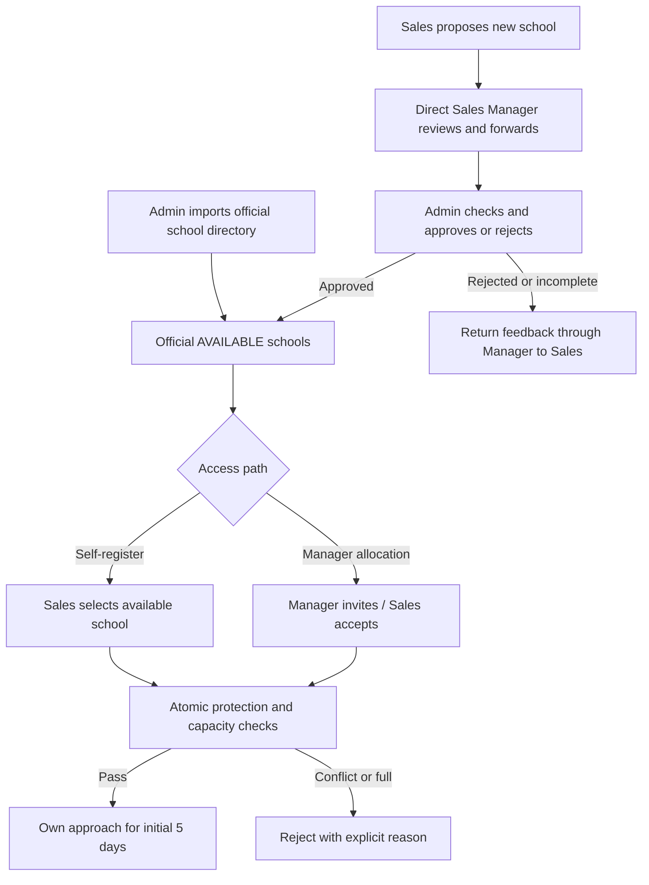
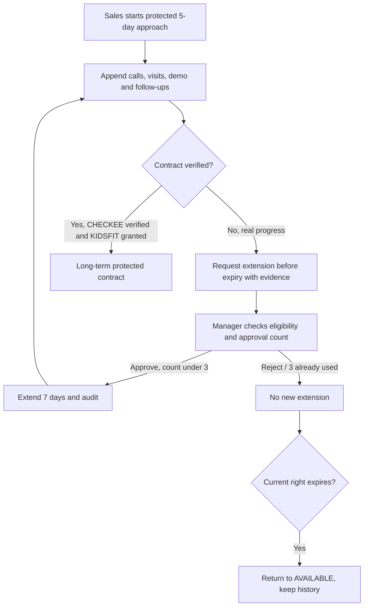
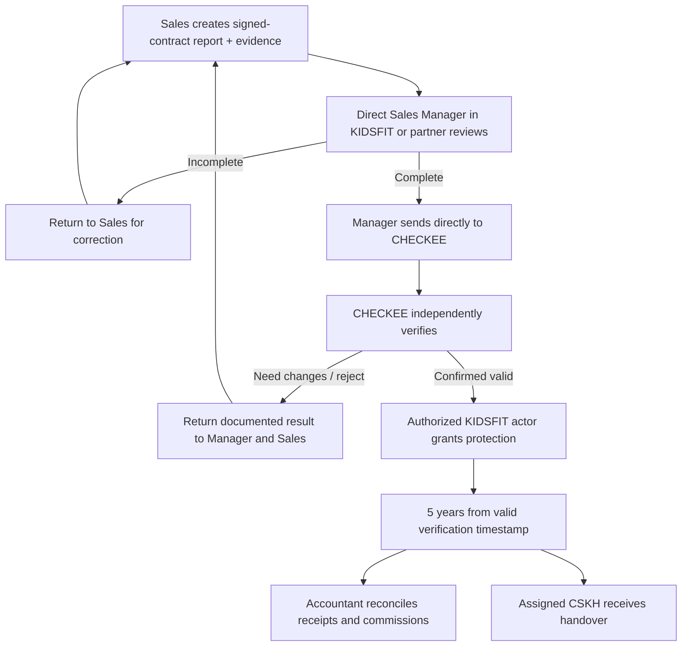

# Cross-role CRM workflows — baseline 2026-10-30

All actions require active user/membership, permission+row-scope enforcement, actor/time/reason audit, idempotency as appropriate, and concurrency-safe transactions. Distinguish business-approved behavior from current implementation.

## WF-01 School source, proposal and registration

`SchoolProposal` is separate from canonical `School` and from `ApproachClaim`. A manager from a partner sees only own team's submissions. Admin owns the canonical write.

## WF-02 Interactions, extension, expiry

**Concurrency:** a late manager decision cannot restore old ownership if another Sales has already registered. An extension pending review is not an unbounded hold. Holding duration and escalation SLA remain OPEN.

## WF-03 Contract review, CHECKEE and long-term protection

No routine Admin or Director gate before CHECKEE; no 5-year protection on manager submit, contract report or partial payment. **OPEN:** exact KIDSFIT permission owner for `grant-protection` action. A failed/stale grant does not override a valid newer active owner.

## WF-04 Financial installments and commissions

1. Accountant establishes contract schedule and records each verified receipt with unique transaction reference, amount, date and method.
2. System computes amount collected, refunds, receivable and outstanding independently of contract face value; never invents collection from signature.
3. Commission ledger records eligible earnings under an **authorized active, versioned policy**, and separate adjustments and payout states.
4. Sales sees own amount entitled/approved/paid; others see only permitted scope.
5. **30% is provisional**, and its calculation base and trigger remain OPEN; a code path must not silently apply it to real transactions.
6. Refund/contract termination does not overwrite original receipt or paid entries. Adjustment policy requires approval.

## WF-05 Sales departure, inactive schools and disputes

Manager reviews ownership, customers, contact history, follow-up tasks and organizational communication channels; authorization service suspends membership, releases validly approved uncontracted slots, and manager reassigns. Preserve historical reports, qualified commissions and prior owner log. Unclaimed/remote school: manager assesses staffing, remote demo or partner option; if not feasible, record pause reason and review date. Director escalates bias, disputes and manager inaction with evidence; does not adjudicate every ordinary contract.

## Status separation

- **Overview** derived from protection/contract: AVAILABLE, APPROACHING, CONTRACTED.
- **Sales pipeline**: NEW → CONTACTED → MET → CONSULTING → DEMO → NEGOTIATING → PENDING_VERIFICATION → WON, or LOST; allowed skips depend on business checks, do not enforce a rigid funnel absent policy.
- **Contract**: DRAFT → PENDING_MANAGER_REVIEW → PENDING_CHECKEE → VERIFIED / CORRECTION_REQUESTED / REJECTED → PROTECTED after authorized KIDSFIT grant (exact machine codes require mapping to current schema, not blind enum migration).
- **Payment**: scheduled, partially collected, fully collected, refunded/cancelled as distinct facts.
